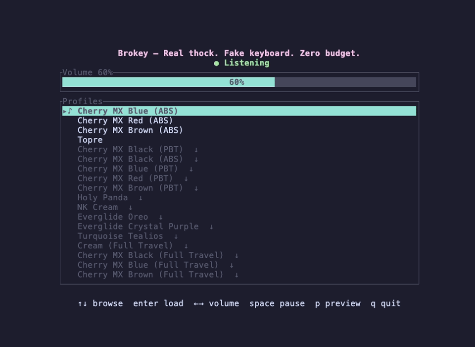

# brokey

Real thock. Fake keyboard. Zero budget.

Brokey plays mechanical-switch sounds on every global keypress, with a small terminal UI.



## Install / run

### Download release binaries

Download the binary for your platform from the [releases page](https://github.com/ntk148v/brokey/releases), extract it, and run:

```bash
# Linux / macOS
chmod +x brokey
./brokey

# Windows
brokey.exe
```

### Build from source

```bash
cargo install --path .
cargo run --release
```

## Build dependencies (Linux)

On Debian/Ubuntu:

```bash
sudo apt install libasound2-dev libx11-dev libxtst-dev
```

## Permissions

- **macOS:** grant **Input Monitoring** _and_ **Accessibility** to the terminal app in System Settings → Privacy & Security, then restart brokey.
- **Linux:** needs an X11 session; on Wayland only XWayland apps are heard (documented, not worked around).
- **Windows:** none.

## Keys

| Key                  | Action                                                  |
| -------------------- | ------------------------------------------------------- |
| `↑` / `k`            | Move cursor up (does not change the sound)              |
| `↓` / `j`            | Move cursor down (does not change the sound)            |
| `Enter`              | Load the cursor profile; downloads it first if optional |
| `d` / `Delete`       | Delete the downloaded optional pack under the cursor    |
| `←` / `-`            | Volume −10% (0–100)                                     |
| `→` / `+` / `=`      | Volume +10% (0–100)                                     |
| `Space`              | Pause/resume                                            |
| `p`                  | Preview the active profile                              |
| `q`, `Esc`, `Ctrl-C` | Quit                                                    |

## Config

Config location: `<config dir>/brokey/config.toml`, where the config dir is what `dirs::config_dir()` returns (macOS `~/Library/Application Support`, Linux `~/.config`, Windows `%APPDATA%`).

Example:

```toml
profile = "mx-blue"
volume = 60
```

Volume is an integer 0–100. Volume saves immediately. The profile preference
saves only after a profile is successfully loaded with `Enter`, so browsing the
list does not rewrite your saved choice.

## Profiles

### Default profiles (embedded)

These are compiled into the binary and work with no network:

- `mx-blue` "Cherry MX Blue (ABS)"
- `mx-red` "Cherry MX Red (ABS)"
- `mx-brown` "Cherry MX Brown (ABS)"
- `topre` "Topre"

### Optional profiles (downloaded on first use)

These appear in the same list. Move the cursor with `↑`/`↓`; the pack only
changes when you press `Enter`. If the cursor is on an optional pack that is not
downloaded, `Enter` downloads it from this repository's
`assets/sounds-optional/` directory and caches it at
`<config dir>/brokey/packs/<id>/`. Rows that are not downloaded show a `↓`
marker; a download in progress shows `…`. Until a download finishes, the
previous pack keeps playing.

`d` (or `Delete`) removes a downloaded optional pack from the cache. If it is
playing, brokey switches to the first embedded pack. Embedded packs and packs
in `sounds/` cannot be deleted this way; remove a custom pack by deleting its
folder. `Enter` downloads a deleted pack again.

A saved optional profile that is not cached falls back to the first embedded
pack at startup instead of downloading silently; the cursor stays on the saved
profile and `Enter` fetches it. The `▸` marker shows the cursor and `♪` shows
the pack actually playing.

- `mx-black` "Cherry MX Black (PBT)"
- `mx-black-abs` "Cherry MX Black (ABS)"
- `mx-blue-pbt` "Cherry MX Blue (PBT)"
- `mx-red-pbt` "Cherry MX Red (PBT)"
- `mx-brown-pbt` "Cherry MX Brown (PBT)"
- `holy-panda` "Holy Panda"
- `nk-cream` "NK Cream"
- `eg-oreo` "Everglide Oreo"
- `eg-crystal-purple` "Everglide Crystal Purple"
- `turquoise` "Turquoise Tealios"
- `cream-travel` "Cream (Full Travel)"
- `mx-black-travel` "Cherry MX Black (Full Travel)"
- `mx-blue-travel` "Cherry MX Blue (Full Travel)"
- `mx-brown-travel` "Cherry MX Brown (Full Travel)"

Embedded and optional packs use real per-key recordings: letters, digits,
common punctuation, Space, Enter, Backspace, and Tab each have their own sample
where the source pack provides one. Keys without a recording, and the preview
key, rotate through natural fallback takes from the same pack. Full-travel
packs only have per-key samples for Backspace, Enter, and Space; the rest use
their generic takes. Upstream `mxblue-travel` currently ships only generic
takes, so that pack uses its defaults for every key.

## Custom sound packs

Put custom packs in `<config dir>/brokey/sounds/<name>/`.
`<name>/press.wav` is required; optional `space.wav` and `release.wav` (played when a key comes back up). The directory name becomes the profile id and name. A pack needs a file with stem `press`, in WAV or FLAC format. Packs that collide with any catalog id or fail to decode are skipped with a warning shown in the UI.

A folder can instead use the bundled per-key format: `config.json` plus a mono
`sound.flac`, like the folders under `assets/sounds/`. Copying a downloaded
pack from `<config dir>/brokey/packs/` works if you give the folder a new name. The manifest may add an
optional `"release": [[start, len], ...]` list of key-up clips.

Each sound plays at a slightly random speed (±3%) so repeated keys don't sound identical.

The bundled and optional sounds are real recordings from MIT-licensed packs; see `assets/CREDITS.md` for provenance and attribution.

Brokey uses the keycode only to choose a sound; it does not build, log, or store
text. No audio is recorded. The network is used only when an optional profile is
selected for the first time; brokey then requests that pack's `config.json` and
`sound.flac` from this repository and nothing else. There is no telemetry.
